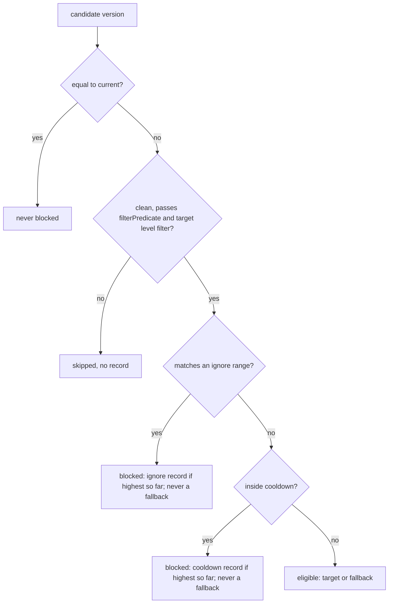
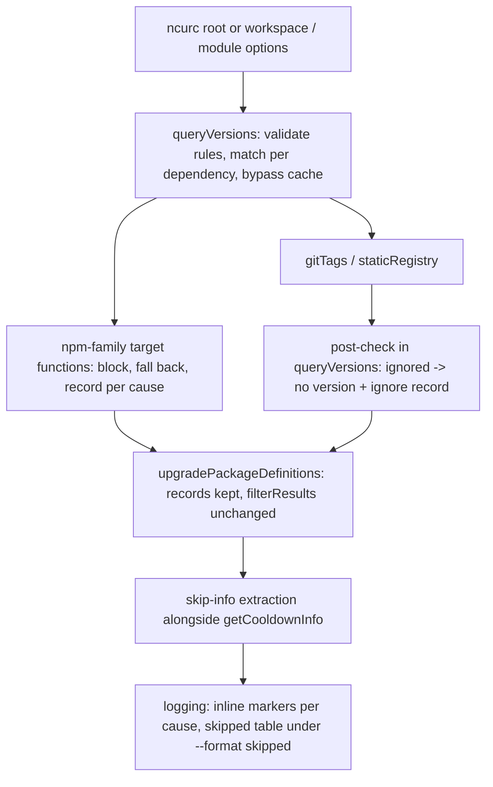

## Goal Capsule

- **Objective:** A project can keep specific versions of a dependency out of ncu's suggestions with a few lines of plain config, still get the best version that isn't ignored, and see which versions were held back and why (issue #1536).
- **Means:** ignored versions are held back by the same per-target block-and-fall-back machinery cooldown uses, and the records it leaves are rendered under a shared `--format skipped` (KTD1, KTD2).
- **Product authority:** This Product Contract, then the Planning Contract's KTDs, then the units. An R wins on product behavior, and a KTD wins on mechanism.
- **Execution profile:** one TypeScript change set in `src/` plus tests in `test/` and regenerated option files. No migration, no new dependency.
- **Stop conditions:** stop and report if keeping `--target @latest` strict (R7) turns out to require changing cooldown's own version selection, or if a cooldown test in `test/cooldown.test.ts` has to change its expected output to make room for ignore.
- **Finishing:** `lfg` implements, reviews and opens the PR. Merging stays with the maintainer.
- **Open blockers:** None.

---

## Product Contract

### Summary

Add a config-only `ignore` option. It maps package names or globs to a semver range of versions ncu must never suggest, optionally with a human-readable reason. Ignored versions are skipped the same way cooldown skips versions that are too new: `--target latest` falls back to the best version that isn't ignored, and `--target @latest` stays strict. A new `--format skipped` value lists everything held back by cooldown or by ignore rules, with reasons. `--format cooldown` stays as an alias.

### Problem Frame

Projects get stuck behind their ecosystem. One example is a react-admin app that can't take `@mui/*` 8 or 9 until react-admin supports them. Another is a team that needs to skip one known-bad release such as `eslint-config-prettier@9.1.1`. Today the only precise tool is `filterResults`. It is a function, so it only works in `.ncurc.js` or the module API, and it drops the whole upgrade instead of offering the next acceptable version. `reject` is declarative, but it hides every upgrade to the package. Dependabot (`ignore`), Renovate (`allowedVersions`), npm-upgrade (ignore list with a reason), and the VS Code upgrade extensions all offer a declarative per-package version ignore, and users of ncu-based tools ask for the same.

### Key Decisions

- **A new `ignore` option, separate from `filter`, `reject`, `filterVersion`, `rejectVersion` and `filterResults`.** The existing filters run on the package or its current version, or drop results after fetching. Their semantics stay unchanged. Governs R1. (session-settled: user-directed — chosen over extending `filterResults` or `reject` with object values: keeps existing filter semantics intact.)
- **Ignored versions behave like cooldown-blocked versions, fallback and strictness included.** Governs R6, R7, R8. (session-settled: user-directed — chosen over dropping the upgrade like `filterResults` and over peer-style fallback that ignores the `latest`/`@latest` distinction: the cooldown fallback has drawn no complaints, and its skip record is what feeds reasons back to the user.)
- **The fallback is not capped at the latest dist-tag version, matching cooldown.** It may suggest a stable version that was never tagged latest, including one above the ignored latest. Governs R6. (session-settled: user-directed — chosen over capping the fallback below the latest tag: one rule shared with cooldown.)
- **Ignore markers, ignore rows and reasons appear only with `--format`, via one value shared with cooldown. Cooldown's inline marker stays in default output as it does today.** Governs R11, R12, R13. (session-settled: user-directed — chosen over always printing a held-back section after the table: default output stays unchanged.)
- **The shared value is a new `skipped`, and `cooldown` stays as an alias.** Governs R11, R13. (session-settled: user-approved — chosen over reusing `cooldown` for both and over a separate `ignore` value: one flag shows everything, existing scripts keep working.)
- **Keys are package names or globs, and the version range lives only in the value.** Governs R2, R3. (session-settled: user-directed — chosen over the issue's `name@range` key syntax such as `@mui/*@>=5.0.0`: the range belongs in the entry's value.)
- **Config file and module API only, no command-line form.** Governs R1. (session-settled: user-approved — chosen over a `--ignore 'name@range'` CLI string: rules with reasons are standing project config, so no second syntax.)

### Requirements

#### Rule definition

- R1. `ignore` can be set in any supported `.ncurc` format (JSON, YAML, JS) and in the programmatic options, and is documented as unavailable on the command line, like `filterResults`.
- R2. `ignore` is an object whose keys are package names or globs, matched with the same name and glob rules as `--filter`, so `@mui/*` covers every package in the scope.
- R3. Each value is either a semver range string (`"^8 || ^9"`, `"9.1.1"`) or an object `{ versions, reason }`, where `versions` is a semver range and `reason` is an optional string.
- R4. A version is ignored for a package when it satisfies the range of any rule whose key matches that package. Every distinct reason from the matching rules is shown.
- R5. An invalid range or a malformed rule value stops the run with an error that names the offending key, the same way an invalid filter does today.

#### Version selection

- R6. With `--target latest`, an ignored latest version falls back to the greatest acceptable version above the current one, following the same rules as the cooldown fallback. Deprecated versions and prereleases stay excluded as they are today.
- R7. With `--target @latest` or any `@tag` target, an ignored tagged version results in no upgrade for that package, matching cooldown's strict behavior.
- R8. With `greatest`, `newest`, `minor`, `patch` and `semver` targets, ignored versions are never chosen. Each target picks its best version that isn't ignored.
- R9. A package's current version is never treated as an upgrade candidate or reported because it falls inside an ignored range. Versions outside the range are still offered.
- R10. Dependencies resolved from git URLs or a static registry never upgrade to an ignored version. When the version those sources pick is ignored, there is no upgrade for that package.

#### Reporting

- R11. `--format skipped` shows, for each package and each cause (cooldown or ignore), the highest version that cause held back above the version chosen. This matches cooldown's existing single record. Each row carries its cause and, for ignore rules, the rule's reason when one is set.
- R12. Without `--format skipped` (or its alias), output for runs that use ignore rules looks the same as output without them, apart from the version chosen.
- R13. `--format cooldown` keeps working as an alias for `skipped`, and existing cooldown output, including its time information, still appears under it.
- R14. When cooldown and an ignore rule both hold back versions of the same package, each held-back version is listed with its own cause.

#### Consistency across modes

- R15. Ignore rules apply wherever ncu chooses versions: plain checks, `-u`, `--interactive`, `--doctor`, workspaces, `--global`, the `--peer` re-check, and the programmatic API.
- R16. The `ignore` option and its rule types are exported in the public option types, so tools built on ncu can pass rules programmatically.

### Acceptance Examples

Shared setup unless stated otherwise: `"@mui/icons-material": "7.2.0"` in package.json. Published stable versions are 7.3.0, 8.0.0 and 9.1.0, and the latest tag is 9.1.0. Config:

```json
{
  "ignore": {
    "@mui/*": { "versions": "^8 || ^9", "reason": "Waiting for react-admin support" }
  }
}
```

- AE1. Fallback under the default target.
  - **Covers R2, R3, R6.**
  - **When:** `ncu`
  - **Then:** suggests `7.2.0 → 7.3.0`.
- AE2. Strict tag target.
  - **Covers R7.**
  - **When:** `ncu --target @latest`
  - **Then:** no upgrade for `@mui/icons-material`.
- AE3. Held-back report.
  - **Covers R11.**
  - **When:** `ncu --format skipped`
  - **Then:** the main row shows `7.2.0 → 7.3.0` with an inline marker that 9.1.0 was ignored, and the skipped table lists 9.1.0 with "Waiting for react-admin support".
- AE4. Default output stays quiet.
  - **Covers R12.**
  - **When:** `ncu` with no format flag
  - **Then:** no ignore marker, section or reason appears.
- AE5. One bad release.
  - **Covers R3, R6.**
  - **Given:** the rule `"eslint-config-prettier": "9.1.1"`, current `9.0.0`, latest tag `9.1.1`, and `9.1.0` published.
  - **When:** `ncu`
  - **Then:** suggests `9.1.0`. Once `9.1.2` is published as latest, ncu suggests `9.1.2`.
- AE6. Already inside the range.
  - **Covers R9.**
  - **Given:** current `9.0.0` with the `@mui/*` rule.
  - **When:** `ncu`
  - **Then:** `9.0.0` is not reported as skipped, no `9.x` upgrade is suggested, and a published `10.0.0` would be suggested.
- AE7. Both causes on one package.
  - **Covers R14.**
  - **Given:** latest 9.1.0 is ignored and 7.3.0 is inside a 7-day cooldown, with 7.2.5 above current 7.2.0.
  - **When:** `ncu --cooldown 7 --format skipped`
  - **Then:** suggests 7.2.5 and lists 9.1.0 (ignored, with reason) and 7.3.0 (cooldown) as skipped.
- AE8. Untagged version above latest.
  - **Covers R6.**
  - **Given:** 10.0.0 is published under the `next` tag as a stable version.
  - **When:** `ncu`
  - **Then:** suggests 10.0.0, as cooldown's fallback would.
- AE9. Bad rule.
  - **Covers R5.**
  - **Given:** `"ignore": { "react": "not a range" }`
  - **When:** `ncu`
  - **Then:** the run stops with an error naming `react`.

### Scope Boundaries

- No command-line form of `ignore` and no `name@range` string syntax.
- No command for adding, listing or removing rules, and no interactive-mode keybinding for creating one.
- No warning for stale rules that no longer match any published version, and no automatic removal of rules.
- No default-on summary line or count of held-back upgrades. Reporting only happens through `--format skipped`.
- No change to how `filter`, `reject`, `filterVersion`, `rejectVersion` or `filterResults` behave.
- No change to cooldown's version selection or its default inline marker. Its skipped table moves under the shared `skipped` value, with `cooldown` kept as an alias.
- Not built: a way for tools to read held-back versions and reasons. The module API returns upgraded versions only, and reasons are printed text. This would change if an ncu-based tool asks for the data.
- Not built: the skipped table under `--doctor`. Doctor's own summary prints without skip data today, for cooldown too.
- Not built: deep-merging a workspace's `ignore` with the root one under `--mergeConfig`. The merge stays shallow, as it is for every other object option, so a workspace `ignore` replaces the root rules.
- Not built: a `--verbose` line for a rule whose key matches no dependency. A typo'd key does nothing, which is consistent with having no stale-rule warning.

### Sources / Research

- Cooldown fallback and strict `@latest` behavior: `src/package-managers/npm.ts` (`findTargetAndFallback`, `toVersionResult`, `distTag`, `latest`), with help text in `src/cli-options.ts` for `--cooldown` and `--target`.
- Shared version predicate (deprecated, prerelease, engines, peer): `src/package-managers/filters.ts` `filterPredicate`. When a tag's version fails it, both `latest` and `@latest` fall through to `greatest`.
- Sources that bypass the predicate: `src/package-managers/gitTags.ts`, `src/package-managers/staticRegistry.ts`.
- Post-fetch filtering with no fallback: `src/lib/upgradePackageDefinitions.ts` (`filterResults`).
- Cooldown reporting: `src/lib/logging.ts` (`toDependencyTable` inline `[cooldown]` column, `printSkippedByCooldownTable`), `src/lib/getCooldownInfo.ts`.
- Pre-fetch name and glob matching to reuse for keys: `src/lib/filterAndReject.ts`.
- Re-runs that must also honor rules: `src/lib/getIgnoredUpgradesDueToPeerDeps.ts`, `src/lib/getIgnoredUpgradesDueToEnginesNode.ts`.
- Config loading: `src/lib/getNcuRc.ts`. Options marked `cli: false` are documented as rc-only but are not rejected on the command line (`src/bin/cli.ts`).
- Prior art from the issue thread: Dependabot `ignore`, Renovate `packageRules[].allowedVersions`, npm-upgrade's ignore list with a reason.

**Product Contract preservation:** clarified, no scope change. R4 now says how overlapping rules' reasons combine. R11 now names the per-cause highest held-back version, matching cooldown's single record and AE3. The reporting Key Decision and the cooldown scope bullet now state that cooldown's default inline marker stays. The Outstanding Questions deferred to planning are now resolved in KTD3, KTD7 and KTD8, and `--format lines` turned out to be moot. Scope Boundaries gained four considered-and-not-built items.

---

## Planning Contract

### Key Technical Decisions

- KTD1. **Ignore is a block cause next to cooldown, not a `filterPredicate` entry.** In `distTag`, a tag version that fails `filterPredicate` falls through to `greatest` even for `--target @latest`, so putting ignore there would make `@latest` fall back silently. Instead, the ignore check sits beside each cooldown check: the early return in `distTag`, and the per-version block test in `findTargetAndFallback`. When several conditions apply to one version, the order depends on the path:
  - In `findTargetAndFallback`, the order is equal-to-current (never blocked), clean-version and `filterPredicate`, the target's level or range `filter`, then ignore, then cooldown. That way only versions the target could actually choose are recorded, and cooldown's existing order is untouched.
  - In `distTag`, the order is equal-to-current, ignore, cooldown, then `filterPredicate`.

   Governs R6, R7, R8, R9. (session-settled: user-directed — chosen over peer-style always-fallback and over drop-like-filterResults: cooldown's fallback has drawn no complaints and its skip record carries the reason back.)
- KTD2. **Each cause records the highest version it held back above the version chosen.** The reducer's single `targetBlockedByCooldown` flag becomes per-cause tracking. For each cause, it keeps the highest version that cause blocked above the eventual fallback, and only above current. The existing `cooldownInfo` record stays exactly as it is, so cooldown's default output and tests don't move. Ignore gets its own record on the version result, carrying the version, its time when known, and the reason. So one package can carry one cooldown record and one ignore record at once (AE7). `greatest`, when called from `distTag` or `latest`, returns its records instead of dropping them, and `latest` merges them with the record from `distTag`. Governs R11, R14.
- KTD3. **Rules are resolved per dependency in `queryVersions` and handed to the package manager as plain data.** `queryVersions` knows the dependency key and the real package name, so it matches each rule key against both. It then passes the matching ranges and reasons for that dependency through options. Compiled matchers never go on options, because the npm packument memo key is built with `JSON.stringify(options)`. Governs R2, R4, R15.
- KTD4. **Validation and matcher compilation run in one memoized helper, called from `queryVersions`.** That covers the root config, each workspace's own `.ncurc` (merged in `src/index.ts` without going through `initOptions`), and module callers. It fails through `programError` with the offending key. A non-object `ignore`, which is what `--ignore foo` on the command line produces, fails with a message saying the option is config-only. Governs R1, R5.
- KTD5. **Git-tag and static-registry results are checked once, right after `getPackageVersion` in `queryVersions`.** If the chosen version is ignored, the result becomes no version plus an ignore record. Git results are URLs, so the tag is read with `getGitHubUrlTag` and a leading `v` is stripped first. npm-family results never come back ignored, so the check is a no-op for them. Governs R10.
- KTD6. **The version cache is bypassed for any dependency a rule matches.** Otherwise a cached `latest` from another project, or from before the rule existed, would be returned before the rule is checked. Cooldown already bypasses the cache this way, on both read and write. Governs R6, R15.
- KTD7. **`skipped` and `cooldown` are one format value, checked through a single helper.** One membership helper returns true for `skipped` or `cooldown`, and every format check in logging and runLocal uses it. Values are never rewritten in place, because a workspace `.ncurc` is merged into the options after `initOptions` runs and would miss the rewrite. Help and README list `skipped` with `cooldown` as an alias. Governs R11, R13. (session-settled: user-approved — chosen over reusing `cooldown` for both and over a separate `ignore` value: one flag shows everything, and existing scripts keep working.)
- KTD8. **Rendering stays per cause.**
  - The cooldown inline `[cooldown] x` marker keeps showing by default, as it does today.
  - The inline `[ignored] x` marker and ignore rows appear only under `skipped`/`cooldown`.
  - When the skipped table has only cooldown rows, it keeps today's heading ("Skipped due to N-day cooldown"). When any ignore row is present, the heading is "Skipped", and each row names its cause: the cooldown period, or `ignored` plus the reason.
  - The table can hold more than one row per package.
  - Ignore rows show no `[missing time]` placeholder when the publish time wasn't fetched.
  - In the main table, the `[missing time]` placeholder that the skipped/cooldown format turns on appears only when a cooldown is active. Ignore-only `--format skipped` runs show no placeholder, and cooldown runs print exactly what they do today.

  Governs R11, R12, R13, R14.
- KTD9. **Matching treats prereleases as inside the range, and keys use the `--filter` matcher.** Ranges are tested with `includePrerelease`, so `^9` also holds back `9.2.0-beta.1`. Otherwise prereleases would slip past the rule whenever ncu turns on `--pre` by itself, which it does for a prerelease current version or an `@tag` target. Keys go through `composeFilter` from `src/lib/filterAndReject.ts`, exported for this purpose, so they support exactly what `--filter` does: globs, the unscoped-name convenience, comma lists and `/regex/`. Governs R2, R4.

### High-Level Technical Design

How one version is judged inside the reducer, in KTD1's reducer order. `distTag` checks ignore and cooldown before `filterPredicate` instead:



How records travel from selection to output:



### Assumptions

- When two rules match the same held-back version, their reasons are joined with "; ", per R4. This avoids having to rank rules against each other.
- A held-back version is recorded only when it is above the current version. This avoids reports that look like an ignored downgrade.
- For `--format skipped` without `--cooldown`, publish times aren't fetched just to show them for ignore rows.
- When the peer recursion re-queries, the first pass's skip records are kept.

### Sequencing

U1 first, then U2 and U3 (U3 needs U2's record shape), then U4, then U5. U2 and U3 can be developed together, but U3's tests depend on U2.

---

## Implementation Units

### U1. Ignore option, rule types and validation

**Goal:** `ignore` is a registered, typed, config-only option, and bad rules fail clearly.

**Requirements:** R1, R2, R3, R5, R16. KTD4, KTD9.

**Dependencies:** none.

**Files:**

- `src/cli-options.ts`: new option with `cli: false`, no `parse`, and an extended help block.
- `src/types/IgnoreRules.ts` (new).
- `scripts/build-options.ts`: add the new type to the hard-coded import header.
- `src/types/RunOptions.ts` and `src/types/RunOptions.json`: regenerated.
- `src/lib/getIgnoreRules.ts` (new): memoized validate-and-compile helper.
- `src/lib/filterAndReject.ts`: export `composeFilter`.
- `src/index.ts`: export the rule types.
- `test/ignore.test.ts` (new).
- `test/exports.test.ts`.
- `test/rc-config.test.ts`.

**Approach:**

1. Define the rule types: a map from key to a range string or `{ versions, reason? }`. Name them distinctly from the existing `IgnoredUpgradeDueTo*` types.
2. Register the option and run `npm run build:options` to regenerate RunOptions, the schema and the README sections.
3. The helper normalizes each value to `{ range, reason? }`. It rejects a non-object `ignore`, a value that is neither a string nor an object, a missing or invalid `versions` (`semver.validRange` returns null), and a non-string `reason`. Each rejection goes through `programError` and names the key.
4. The helper exposes a lookup that returns the matching `{ range, reason }` entries for a dependency key and a real package name.

**Patterns to follow:** `filterResults` and `groupFunction` option definitions. Cooldown validation messages in `src/lib/initOptions.ts`. Picomatch matchers in `nativeCooldown()`.

**Test scenarios:**

- `{ "react": "^18" }` and `{ "react": { versions: "^18", reason: "x" } }` both normalize, and the lookup for `react` returns range `^18`.
- Covers AE9: `{ "react": "not a range" }` rejects with a message naming `react`.
- `ignore: "react@18"` (a string, as a CLI flag would produce) rejects with a config-only message.
- `{ "react": { reason: "x" } }` (no `versions`) and `{ "react": 5 }` reject, naming the key.
- `@mui/*` matches `@mui/material` and not `react`. An exact name matches only itself.
- A rule loaded from `.ncurc.json` and from `.ncurc.yml` reaches options unchanged as an object.
- The rule types are importable from the package entry.

**Verification:** a typed `ignore` works in `defineConfig` without type errors, and the generated schema accepts both value forms.

### U2. Ignore as a block cause in npm-family version selection

**Goal:** every npm-family target skips ignored versions with cooldown-style fallback and strictness, and leaves per-cause records.

**Requirements:** R6, R7, R8, R9, R14. KTD1, KTD2, KTD9.

**Dependencies:** U1.

**Files:**

- `src/package-managers/npm.ts`: `findTargetAndFallback`, `toVersionResult`, `distTag`, `latest`, `greatest`.
- `src/package-managers/filters.ts`: an ignore-match helper next to `satisfiesCooldownPeriod`.
- `src/types/VersionResult.ts`.
- `src/types/` (new skip-record type).
- `test/ignore.test.ts`.

**Approach:**

1. Add an ignore-match helper that tests a version against the dependency's resolved ranges with `includePrerelease`. Nothing is ignored when the dependency has no ranges.
2. In the reducer:
   - Test ignore before cooldown, per KTD1.
   - An ignored version can never be the fallback.
   - Track the highest blocked version per cause above the fallback and above current (KTD2).
   - Mirror the existing guard so the current version is never blocked.
3. In `toVersionResult`, build the ignore record alongside the unchanged `cooldownInfo` construction. A result can be a version with records, or records with no version.
4. In `distTag`:
   - Add the ignore early return beside the cooldown one, before the `filterPredicate` fall-through. That keeps `@latest` and `@tag` strict.
   - A tag version equal to current is never ignored.
5. Have `greatest`, when called from `distTag` or `latest`, return its records.
6. Have `latest` fall back on any record, not only `cooldownInfo`, and merge the records.

**Execution note:** start with characterization runs of the existing `test/cooldown.test.ts` target blocks. They must stay green unchanged through this unit.

**Patterns to follow:** `describe` blocks per target in `test/cooldown.test.ts`. Stub with `test/helpers/stubVersions.ts` and `createMockVersion`.

**Test scenarios:**

- Covers AE1: current 7.2.0, published 7.3.0, 8.0.0 and 9.1.0, latest 9.1.0, rule `^8 || ^9`. `--target latest` gives 7.3.0.
- Covers AE2: same setup with `--target @latest` gives no upgrade.
- `--target @next`, where `next` points to an ignored version, gives no upgrade.
- `greatest`, `minor`, `patch` and `semver` each skip the ignored versions their target would otherwise pick. Use a `minor` setup where 7.4.0 is ignored and 7.3.0 is not.
- `newest` picks the most recently published version that isn't ignored.
- `--target minor` from 7.2.0 with an ignored 9.1.0 produces no ignore record, because 9.1.0 is outside the minor range.
- A run without `--pre` never records an ignored prerelease such as `9.2.0-beta.1`.
- Covers AE5: current 9.0.0, latest 9.1.1, rule `9.1.1`, 9.1.0 published. The result is 9.1.0.
- Covers AE6: current 9.0.0 inside `^9`. No 9.x upgrade, no record for 9.0.0, and 10.0.0 is suggested when published.
- Covers AE8: an untagged stable 10.0.0 above an ignored latest 9.1.0 is suggested.
- Covers AE7: latest 9.1.0 is ignored, 7.3.0 is in cooldown, 7.2.5 is available, current 7.2.0. The result is 7.2.5, with an ignore record for 9.1.0 and a cooldown record for 7.3.0.
- A deprecated latest plus an ignored greatest, under `latest`, falls back to the next acceptable version and keeps the ignore record.
- A prerelease 9.2.0-beta.1 is held back by `^9` when the current version is a prerelease.
- When everything above current is ignored, the result is no version plus a record.
- With no rules, results are identical to today.

**Verification:** the existing cooldown and target test files pass unchanged, and every scenario above passes.

### U3. Rule resolution, cache bypass and non-npm sources in queryVersions

**Goal:** rules reach every version lookup for the right dependency, and no path suggests an ignored version.

**Requirements:** R2, R4, R10, R15. KTD3, KTD4, KTD5, KTD6.

**Dependencies:** U1, U2.

**Files:**

- `src/lib/queryVersions.ts`.
- `src/types/Options.ts`: internal per-dependency rule field.
- `test/ignore.test.ts`.
- `test/cache.test.ts`.
- `test/registryType.test.ts`.
- `test/test-data/` (static registry fixture if a new one is needed).

**Approach:**

1. At the top of `queryVersions`, call the U1 helper. That validates rules once per run, including for workspace `.ncurc` options.
2. For each dependency, match rules against the dependency key and the real package name (for npm aliases). Pass the matched ranges and reasons through per-call options.
3. Skip cache read and write for matched dependencies, mirroring the cooldown branches.
4. After `getPackageVersion`, run the KTD5 post-check for results that come back ignored, which only git-tag and static-registry sources can produce.
5. Keep results that carry only an ignore record in the result filter, which today keeps `version || error || cooldownInfo`.

**Patterns to follow:** cooldown cache bypass and its tests in `test/cache.test.ts`. Static registry usage in `test/registryType.test.ts`.

**Test scenarios:**

- An alias `"mui": "npm:@mui/material@7.2.0"` is held back by a rule keyed `mui` and also by one keyed `@mui/material`.
- Two overlapping rules (`@mui/*` reason A, `@mui/material` reason B) on the same version produce one record whose reason contains both A and B.
- With `--cache` and a cached `latest` of 9.1.0, a rule `^9` still gives 7.3.0, and 7.3.0 is not written to the cache.
- A static registry whose version for a package is ignored gives no upgrade and an ignore record (covers R10).
- A git-URL dependency whose chosen tag `v2.0.0` is ignored by `^2` gives no upgrade. Stub the tag lookup rather than calling the network.
- In a workspaces run, a workspace `.ncurc` with an invalid rule fails with the key named, and a valid workspace rule applies to that workspace only.
- The peer re-check lists (`getIgnoredUpgradesDueToPeerDeps`) never propose an ignored version.
- A `-u` run writes the fallback version, not the ignored one, to package.json.

**Verification:** all of the above pass, and `test/cache.test.ts` cooldown cases pass unchanged.

### U4. Skipped reporting and the shared format value

**Goal:** `--format skipped` shows every held-back version with its cause and reason, `cooldown` still works, and default output gains nothing from ignore.

**Requirements:** R11, R12, R13, R14, R15. KTD7, KTD8.

**Dependencies:** U2, U3.

**Files:**

- `src/cli-options.ts`: format `choices`, description and extended help row.
- `src/lib/getCooldownInfo.ts`: extend it, or add a sibling extractor, to collect ignore records.
- `src/lib/logging.ts`: `toDependencyTable`, `printSkippedByCooldownTable`, `printUpgrades`.
- `src/lib/runLocal.ts`.
- `src/lib/runGlobal.ts`.
- `test/ignore.test.ts`.
- `test/logging.test.ts`.
- `test/format.test.ts`.
- `test/cli-options.test.ts`.

**Approach:**

1. Add `skipped` to the format choices. Add the KTD7 membership helper and route every existing `includes('cooldown')` format check through it.
2. Collect ignore records next to the existing `skippedByCooldown`, and pass them wherever that map goes: `runLocal` (including `chooseUpgrades` for interactive labels), `runGlobal` and `printUpgrades`.
3. In `toDependencyTable`, keep the cooldown column condition as it is today. Show the `[ignored] x` marker only when the helper is true. Gate the main-table `[missing time]` placeholder on an active cooldown, per KTD8.
4. Rework the skipped table so rows are built as a list, allowing more than one row per package. Apply KTD8's heading and cause rules.
5. In `printUpgrades`, let ignore records suppress the "No package versions were returned" message, the same way `numCooldown` does. Leave the "All dependencies … match" wording as it is for ignore-only runs (R12).

**Patterns to follow:** `test/cooldown.test.ts` print tests (around the "print: Skipped due to cooldown" block), using the `getNormalizedLogs` helper.

**Test scenarios:**

- Covers AE3: `--format skipped` prints `7.2.0 → 7.3.0` with `[ignored] 9.1.0`, then a "Skipped" table listing 9.1.0 with "Waiting for react-admin support". No `[missing time]` appears anywhere in the output.
- A workspace `.ncurc` with `format: ["cooldown"]` shows ignore rows for that workspace.
- Covers AE4: the same run with no `--format` prints no ignore marker, table or reason.
- `--format cooldown` produces the same output as `--format skipped` for an ignore-only run.
- A cooldown-only run under `--format cooldown` prints exactly what it prints today, heading included.
- Covers AE7: under `--format skipped`, one package shows two skipped rows, one ignored with its reason and one cooldown with its period.
- `--target @latest` with every dependency ignored prints no "No package versions were returned" message.
- A rule without a reason shows `ignored` with no trailing text.
- `--format skipped` is accepted by validation, and `--format skippd` is rejected with the valid-values list including `skipped`.
- A module call with `format: ['cooldown']` behaves like `['skipped']`.
- `--interactive` choice labels show the ignore marker only under `--format skipped`.
- `--global` with a matched global package and `--format skipped` prints the skipped table.

**Verification:** the cooldown print tests pass unchanged, and the scenarios above pass.

### U5. Documentation

**Goal:** users can find and correctly use `ignore` and `--format skipped` from help and the README.

**Requirements:** R1, R11, R13.

**Dependencies:** U1, U4.

**Files:**

- `src/cli-options.ts`: `ignore` extended help, and the format and cooldown help text that mentions `--format cooldown`.
- `README.md`: regenerated only, via `npm run build:options`.

**Approach:**

1. The `ignore` help shows both value forms, a scope glob, the `latest` vs `@latest` behavior, and that it is config/module only.
2. It includes one sentence warning that, like cooldown, the fallback can pick a stable version above the latest tag.
3. The format help lists `skipped`, and says `cooldown` is an alias.
4. The cooldown help points at `--format skipped`.

**Test expectation:** none. This unit is documentation text. The generated README must match `npm run build:options` output, and `test/cli-options.test.ts` must still pass.

**Verification:** `ncu --help --ignore` and `ncu --help --format` render the new text, and the README sections match the generated output.

---

## Verification Contract

| Gate | Command | Proves |
| --- | --- | --- |
| Types | `npm run lint:types` | New types, generated RunOptions and exports compile |
| Feature tests | `npx vitest run test/ignore.test.ts` | U1–U4 scenarios |
| Regression | `npm run test:unit` | Cooldown, cache, format, logging, peer, workspaces and target behavior unchanged |
| Generated files | `npm run build:options`, then `git diff --exit-code` on `README.md`, `src/types/RunOptions.ts`, `src/types/RunOptions.json` | Generated artifacts are current |
| Lint | `npm run lint` | eslint, markdown and lockfile checks pass |

`test/cooldown.test.ts` must pass with no edits to its expectations.

---

## Definition of Done

- Every R1–R16 is covered by a U-ID, and AE1–AE9 each have a passing test marked `Covers AE<N>`.
- All gates in the Verification Contract pass.
- Default output of a run with no `ignore` rules is byte-identical to before, verified by the unchanged existing test suites.
- No abandoned-attempt code, debug logging or unused helpers remain in the diff.
- README and generated option files come from `npm run build:options`, not hand edits.
